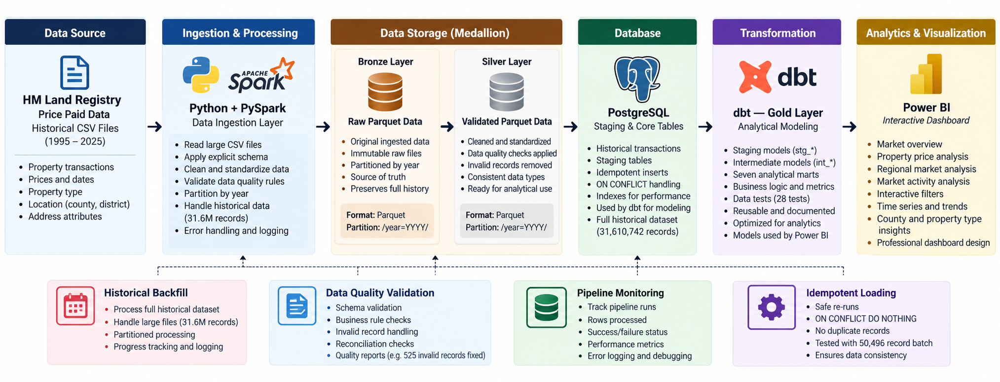
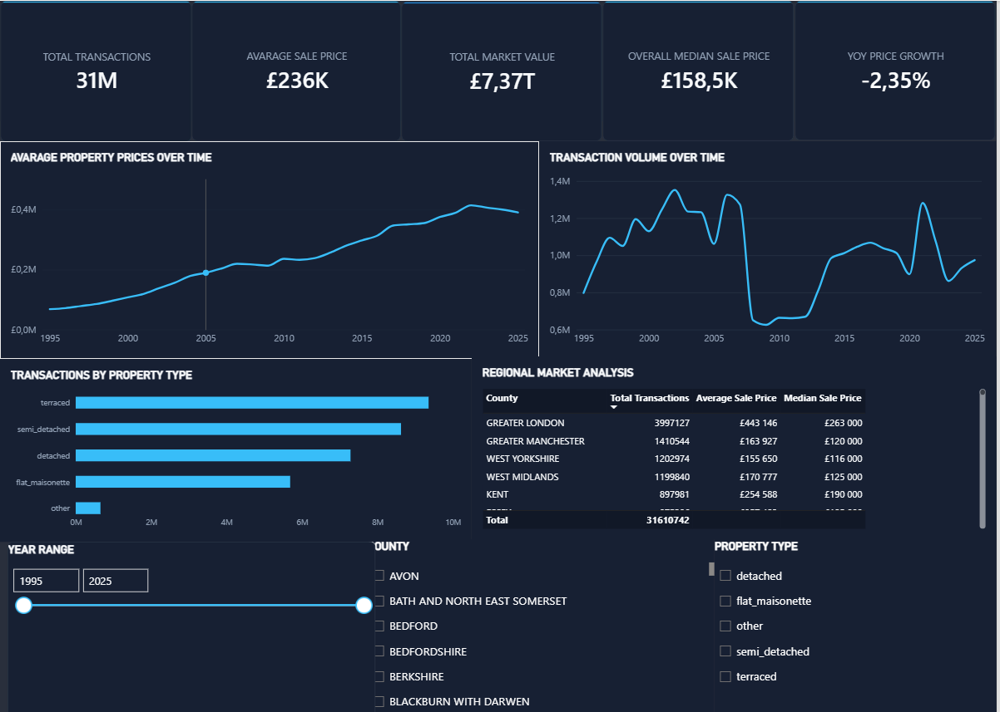
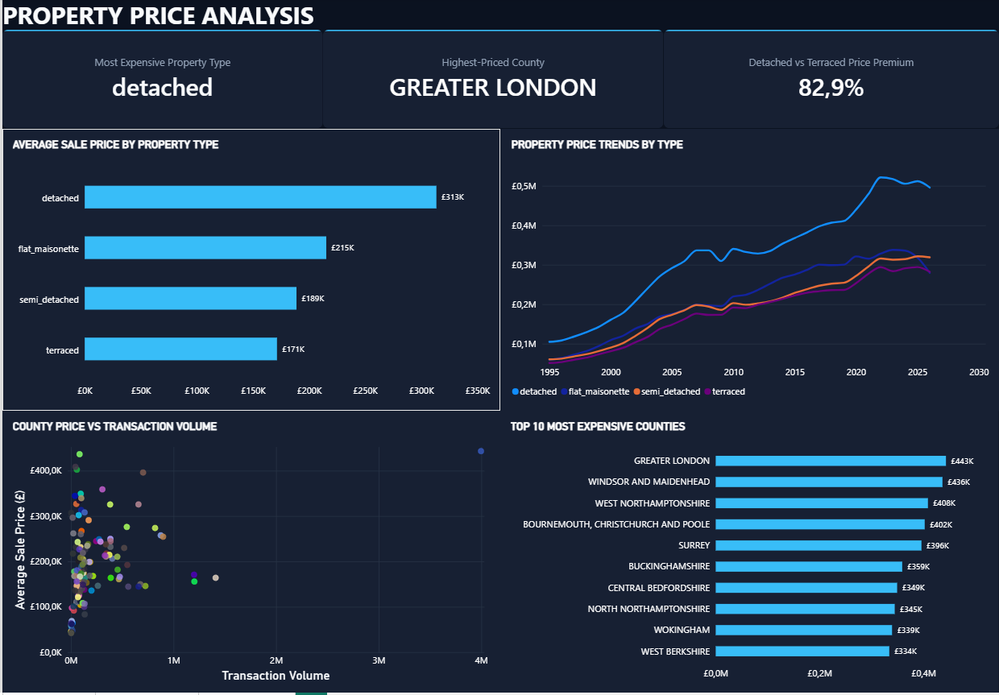
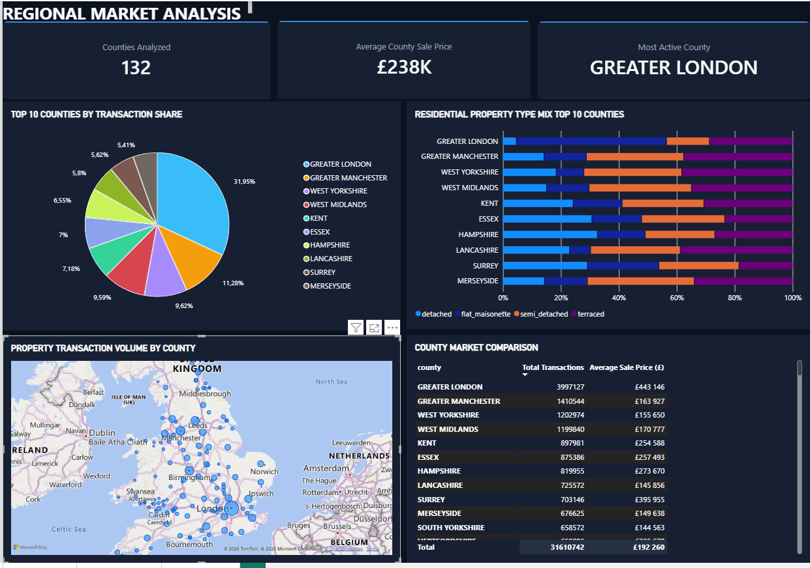
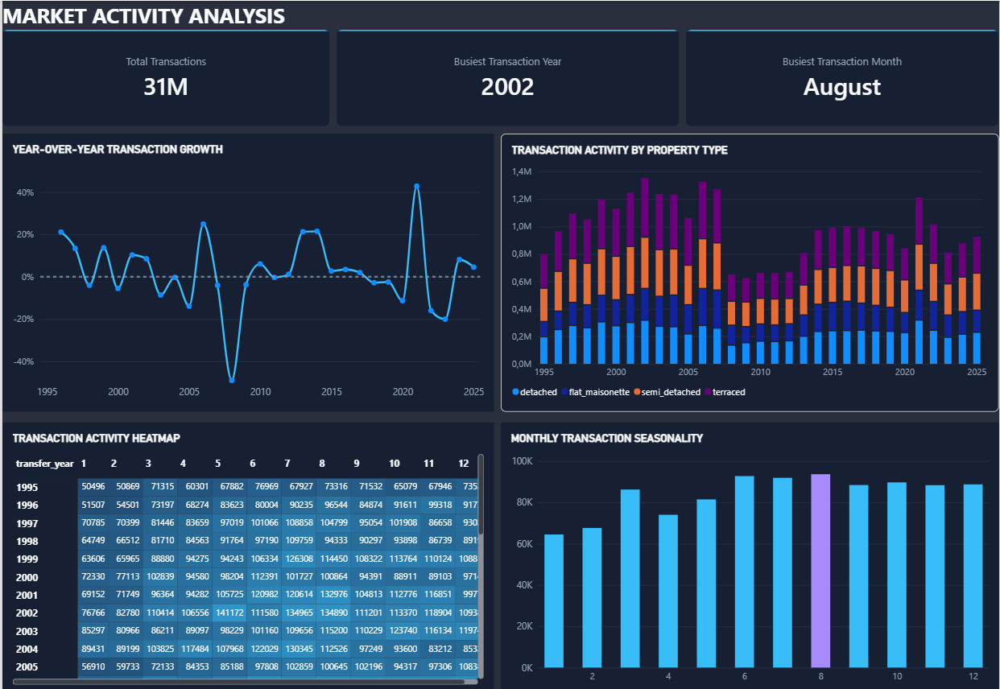

# Real Estate Data Engineering Pipeline

**31.6 million property transactions. One reproducible batch-data workflow. From raw CSV to Power BI.**

**Python · Apache Spark (PySpark) · Parquet · PostgreSQL · dbt · SQL · Power BI**

A hands-on data engineering portfolio project built around **HM Land Registry Price Paid Data** for England and Wales. I expanded an annual-data prototype into a historical pipeline that ingests **31,610,742 transactions**, validates and persists partitioned data, loads PostgreSQL with retry-safe inserts, builds tested analytical marts, and makes the results available in Power BI.

> **What this demonstrates:** Large-file processing, data quality decisions, historical backfills, SQL modeling, idempotent loading, query-performance investigation, and debugging across system boundaries. This is a **local batch implementation**, not a claim of cloud deployment or production operations.



## At a glance

| | Recorded evidence |
|---|---|
| **Scale** | **31,610,742** rows from a ~**5.53 GB** historical CSV; 16 source fields |
| **Historical coverage** | Beginning in **1995**; the recorded PostgreSQL reconciliation reached **2026-08-28** |
| **Ingestion benchmark** | **4 min 33.952 sec** for the corrected Spark ingestion benchmark (one observed run) |
| **Silver validation** | **31,610,742** rows passed the implemented rules after a historical-domain correction |
| **Database reconciliation** | **31,610,742** rows, **31,610,742** distinct transaction IDs, **0** duplicate IDs |
| **Retry behavior** | January 1995 test: **50,496** inserted on first load; **0** on repeat |
| **Analytics** | **7 dbt marts** implemented; **5** connected to Power BI |

*Numbers above are recorded results from project testing and troubleshooting, not results of a fresh run performed for this README.*

## The problem  and why I built it

The HM Land Registry publishes transaction-level property sale records as CSV. The raw historical extract is useful, but it is **not yet an analytics-ready data product**: it needs typed ingestion, consistent validation across decades of records, dependable relational loading, and models that answer market questions without requiring a dashboard to repeatedly process raw transactions.

I built this project to answer a practical engineering question: **How can I take tens of millions of historical property transactions from a raw file to trustworthy, reusable analytical tables?** The initial annual dataset contained approximately **954,145** records; expanding to the full historical extract exposed scale, compatibility, performance, and reliability issues that a smaller sample did not reveal.

The result is a layered batch pipeline that supports analysis of **property sale prices, transaction volumes, county-level trends, and property types**. It is also a record of engineering trade-offs and fixes, not just a dashboard demo.

## Architecture and data flow

**Main path:** `pp-complete.csv` → **Spark DataFrame** → **Bronze Parquet** → **Silver Parquet** → **Spark JDBC** → `staging.price_paid_load` → `staging.price_paid` → **dbt staging / intermediate / Gold marts** → **Power BI**.

**Supporting operations:** Historical partition backfill and recovery, PostgreSQL row-count/uniqueness reconciliation, dbt SQL tests, and pipeline-run tracking in `monitoring.pipeline_runs`. No AWS, Airflow, Kafka, streaming, or external monitoring platform is part of this implementation.

### What each layer does

| Stage | Implementation | Why it matters |
|---|---|---|
| **Source** | HM Land Registry `pp-complete.csv`, headerless, 16 columns | Real, large historical transaction data |
| **Ingestion** | `src/ingest.py`: Spark CSV reader with an explicit schema, including decimal price and date fields | Avoids collecting the entire file into a Python/pandas process |
| **Bronze** | `src/bronze.py`: typed records written to Parquet, partitioned by `transfer_year` and `transfer_month` | Persists an ingestion-stage dataset close to the source |
| **Silver** | `src/silver.py`: trims/uppercases selected fields and validates required values and domain codes; partitioned Parquet output | Applies explicit, inspectable data-quality rules |
| **PostgreSQL** | `src/load_postgres.py`: monthly Silver partition → JDBC load table → SQL merge into `staging.price_paid` | Separates batch transfer from conflict-safe insertion |
| **dbt** | Staging and intermediate views; seven Gold marts materialized as tables | Provides reusable, tested analytical structures |
| **Power BI** | Connected to five PostgreSQL mart tables | Makes market and regional analysis accessible to report users |

**Important behavior:** Bronze and Silver writes use `overwrite`; they are not append-only stores. The PostgreSQL merge uses `ON CONFLICT (transaction_id) DO NOTHING`, which prevents duplicate inserts but **does not update changed source records**.

## Power BI  analytical output

Power BI connects to PostgreSQL and uses five marts: `mart_monthly_market_trends`, `mart_property_type_trends`, `mart_monthly_county_trends`, `mart_county_property_type`, and `mart_market_rankings`.

These are four actual pages from the Power BI report, showing overall market performance, property-price comparisons, regional trends, and transaction activity. The screenshots reflect the dashboard's selected filters and formatting.

### Market overview



*Executive overview of transaction volume, prices, market value, year-over-year price growth and county-level performance.*

### Property price analysis



*Compares prices by property type, examines the detached-versus-terraced premium, and highlights geographic price differences.*

### Regional market analysis



*Explores transaction concentration and property-type mix across counties, alongside a map and regional comparison table.*

### Market activity analysis



*Examines annual transaction growth, activity by property type, the busiest periods, and seasonal patterns.*

**Note:** Dashboard KPIs can be rounded or affected by report filters. The exact 31,610,742-row reconciliation is a separately recorded PostgreSQL result.

## Data modeling: staging → intermediate → Gold

```text
PostgreSQL: staging.price_paid
  └─ stg_price_paid                          [view]
      └─ int_property_transactions          [view]
          ├─ int_monthly_county_metrics     [view]
          ├─ mart_county_market_summary     [table]
          ├─ mart_county_price_statistics   [table]
          ├─ mart_county_property_type      [table]  → Power BI
          ├─ mart_market_rankings           [table]  → Power BI
          ├─ mart_monthly_county_trends     [table]  → Power BI
          ├─ mart_monthly_market_trends     [table]  → Power BI
          └─ mart_property_type_trends      [table]  → Power BI
```

The lineage above is a **simplified presentation of the model layers**, not an assertion that every mart reads directly from the same intermediate view. The SQL models in `models/` are the source of truth for exact dependencies. dbt models are configured as **staging/intermediate views** and **mart tables** in `dbt_project.yml`.

The seven marts support different analytical grains: county summaries, price statistics, county/property-type breakdowns, market rankings, monthly county trends, monthly market trends, and property-type trends. Keeping these calculations in SQL reduces dashboard-specific transformation logic.

## Data quality, reliability and verification

- **Schema:** Spark uses an explicit 16-field schema for Price Paid data (`src/ingest.py`).
- **Silver rules:** `src/silver.py` checks transaction ID, positive price, transfer date, and permitted values for property type, new-build flag, duration, PPD category, and record status. Selected text fields are standardized with `trim` and `upper`.
- **Historical domain correction:** An initial Silver run rejected **525** records with `duration = 'U'` (1995–2007). After investigating the historical value and accepting `F/L/U`, the recorded rerun reported **zero invalid records under the implemented checks**. That is not a claim that every source value is factually correct.
- **Retry-safe loading:** The PostgreSQL target uses `transaction_id` conflict handling. A January 1995 repeat test inserted **zero additional records** after the initial **50,496**.
- **Reconciliation:** `scripts/reconcile_postgres.py` checks target counts, distinct IDs and historical consistency. The recorded final result had **31,610,742 distinct IDs** and **no duplicate IDs**.
- **dbt tests:** Custom SQL tests cover transaction uniqueness, row-count and market reconciliations, mart grain, rankings, and category mapping.
- **Operational traceability:** PostgreSQL table `monitoring.pipeline_runs` records execution status, partitions, row counts, timing, and error information. Historical backfill and targeted recovery scripts are present.

## Engineering challenges  the work behind the result

| Challenge I encountered | Investigation / engineering decision | Outcome and lesson |
|---|---|---|
| **The benchmark failed before reading data** | The benchmark imported nonexistent `read_price_paid`; I corrected it to the implemented `ingest_price_paid(spark, input_path)` interface | Measured the actual ingestion path: **4m 33.952s**. A failed import is not a performance benchmark |
| **Historical records failed a seemingly valid quality rule** | Investigated **525** records with `duration='U'` instead of dropping them | Updated accepted domain to `F/L/U`; recorded full Silver run passed the implemented rules |
| **Spark could not load PostgreSQL JDBC driver** | Identified missing `org.postgresql.Driver` and configured project-local `postgresql-42.7.8.jar` | Driver dependency addressed; debugged integration separately from SQL logic |
| **Retries could duplicate transaction rows** | Loaded by month through a staging table and used primary-key conflict handling | Repeated January 1995 load added **0** rows; full reconciliation found **0** duplicate IDs |
| **Historical aggregation was expensive** | Inspected query plans; tested an index, median-free aggregation, and `work_mem` | Baseline **290.95s**; full query with adjusted memory **198.76s** in a recorded experiment. The tested index was not retained |

**What I would improve next:** Complete a reproducible environment specification, make full database DDL/setup available, and evaluate further performance improvements with measured comparisons. These are **limitations / future work**, not features claimed as implemented.

For a deeper discussion of debugging decisions and what was conclusively verified, see [Engineering Challenges & Interview Notes](docs/engineering-challenges.md) and [Performance Engineering](docs/performance-engineering.md).

## Running the project locally

**Requirements:** Python/PySpark and compatible Java runtime, local PostgreSQL, PostgreSQL JDBC JAR, `psycopg2`, `dbt-core` + `dbt-postgres`, and Power BI Desktop to open the report. The reviewed source snapshot **does not include a complete dependency lockfile or all database setup DDL**, so these commands assume your environment and staging schema have already been configured.

Get the CSV from the official [HM Land Registry Price Paid Data downloads](https://www.gov.uk/government/statistical-data-sets/price-paid-data-downloads). Do not commit the 5.53 GB CSV, generated Parquet, or credentials.

```powershell
# From the project root, with the local Spark/Python environment configured
python -m scripts.test_ingestion
python -m scripts.test_bronze
python -m scripts.test_silver

# With Silver partitions, PostgreSQL and the JDBC JAR configured
python scripts/backfill_historical.py
python scripts/reconcile_postgres.py

# With a local dbt profiles.yml pointing to the real_estate database
dbt debug
dbt run
dbt test
```

The code uses local PostgreSQL at `127.0.0.1:5432/real_estate` and a project-local JDBC JAR (`lib/postgresql-42.7.8.jar`). Configure environment variables and database permissions for your machine. **Never commit `.env`, passwords, or `profiles.yml` containing secrets.**

## Repository guide

```text
src/                  Spark ingestion, Bronze/Silver writes, JDBC loading, monitoring
scripts/              Historical backfill, partition recovery, reconciliation, tests
models/staging/       stg_price_paid
models/intermediate/  Transaction enrichment and monthly county aggregation
models/marts/         Seven Gold analytical marts
models/**/schema.yml  dbt schema documentation/tests
tests/                Custom SQL data-quality and reconciliation tests
sql/monitoring/       Pipeline-run tracking DDL
docs/                 Architecture, engineering casebook and performance notes
macros/               dbt schema naming macro
dbt_project.yml       dbt model materialization settings
```

## Key takeaways

This project taught me that scaling a pipeline is as much about **validating assumptions and making failures observable** as it is about processing more data. The most meaningful improvements came from investigating unexpected historical codes instead of dropping records, verifying retry behavior with real database counts, and using execution plans before choosing performance optimizations.

**Built by [Lwando Sokhanyile](https://github.com/lwando-sokhanyile)** · [Project repository](https://github.com/lwando-sokhanyile/real-estate-pipeline)
